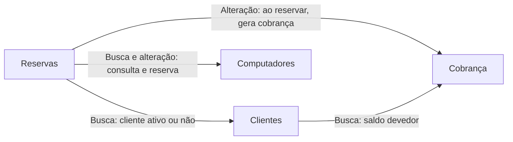
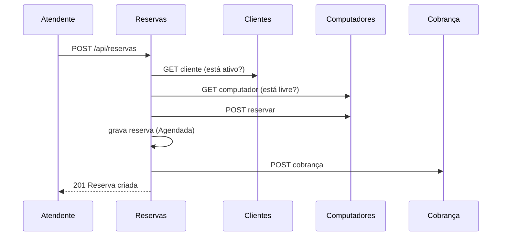

# LanHouse — Back-end em Microsserviços

Projeto da disciplina **Arquitetura de Software** — Engenharia de Software, UNISATC.
Avaliação: Sistemas distribuídos · Professor: Eduardo Cizeski Meneghel

**Equipe:** _Nome 1_ · _Nome 2_ · _Nome 3_

| Serviço | Render (produção) | Documentação interativa |
|---|---|---|
| Reservas | `https://SEU-RESERVAS.onrender.com` | `/scalar` |
| Clientes | `https://SEU-CLIENTES.onrender.com` | `/scalar` |
| Computadores | `https://SEU-COMPUTADORES.onrender.com` | `/scalar` |
| Cobrança | `https://SEU-COBRANCA.onrender.com` | `/scalar` |

> Observação: o plano Free do Render "hiberna" o serviço após alguns minutos sem uso. A primeira requisição pode levar cerca de 50 segundos. Para acordar todos os serviços, acesse `/health` em cada um antes de testar.

---

# 1. Documento de requisitos

## 1.1 Propósito do sistema

Controlar o funcionamento de uma lan house: cadastro de clientes e computadores, reserva de horários e o saldo devedor do cliente. O objetivo é eliminar o uso de anotações manuais e automatizar os processos.

## 1.2 Usuários

Colaboradores da lan house, ou seja, as pessoas que a administram: **gerentes** e **atendentes**.

## 1.3 Requisitos funcionais

| Código | Requisito | Microsserviço |
|---|---|---|
| RF01 | Cadastrar cliente com nome, telefone e situação (ativo ou bloqueado). | Clientes |
| RF02 | Consultar cliente por nome ou telefone. | Clientes |
| RF03 | Cadastrar computador com identificação, tipo e hardware. | Computadores |
| RF04 | Alterar o status de um computador (livre, reservado ou em uso). | Computadores |
| RF05 | Iniciar sessão a partir de um agendamento, somente se o cliente estiver ativo. | Reservas |
| RF06 | Gerar reserva apenas para computadores que estão livres. | Reservas |
| RF07 | Ao reservar, gerar automaticamente a cobrança correspondente. | Reservas → Cobrança |
| RF08 | Consultar o saldo devedor de um cliente. | Clientes → Cobrança |
| RF09 | Finalizar uma sessão, liberando o computador. | Reservas |
| RF10 | Cancelar uma reserva agendada, liberando o computador e cancelando a cobrança. | Reservas |
| RF11 | Registrar o pagamento de uma cobrança. | Cobrança |

### Regras de negócio

- O telefone do cliente é único; a identificação do computador é única.
- A duração de uma reserva vai de 15 a 720 minutos.
- Valor da cobrança = `valor da hora do computador × duração em minutos ÷ 60`.
- Saldo devedor = soma das cobranças com status `Pendente`.
- Status de computador: `Livre`, `Reservado`, `EmUso`. Status de reserva: `Agendada`, `EmAndamento`, `Finalizada`, `Cancelada`. Status de cobrança: `Pendente`, `Paga`, `Cancelada`.

---

# 2. Descritivo técnico

## 2.1 Visão geral

A aplicação é composta por **4 microsserviços** independentes, cada um com seu próprio banco SQLite, API REST e deploy. Todos seguem o template de microsserviço da disciplina (.NET, Entity Framework Core, SQLite, REST, `GeradorDeServicos`, camadas `Controllers` / `Servicos` / `DTO`).



## 2.2 Microsserviços

| Microsserviço | Responsabilidade | Banco | Porta local |
|---|---|---|---|
| **Clientes** | Cadastro, consulta e situação (ativo/bloqueado) dos clientes; consulta do saldo devedor (via Cobrança). | `clientes.db` | 5001 |
| **Computadores** | Cadastro dos computadores (identificação, tipo, hardware, valor da hora) e controle do status. | `computadores.db` | 5002 |
| **Reservas** | Orquestra o fluxo: agenda reservas, inicia e finaliza sessões. Consome os outros três serviços. | `reservas.db` | 5003 |
| **Cobrança** | Gera, paga e cancela cobranças; calcula o saldo devedor por cliente. | `cobranca.db` | 5004 |

## 2.3 Integrações entre microsserviços

| # | Tipo | Origem → Destino | O que acontece |
|---|---|---|---|
| 1 | Busca | Reservas → Clientes | `GET /api/clientes/{id}` — verifica se o cliente existe e está **ativo**. |
| 2 | Busca | Reservas → Computadores | `GET /api/computadores/{id}` — verifica se o computador está **livre**. |
| 3 | Busca | Clientes → Cobrança | `GET /api/cobrancas/cliente/{id}/saldo` — obtém o **saldo devedor**. |
| 4 | Alteração | Reservas → Computadores | `POST /api/computadores/{id}/reservar` — muda o status para `Reservado` (e `PUT .../status` para `EmUso` / `Livre`). |
| 5 | Alteração | Reservas → Cobrança | `POST /api/cobrancas` — **gera a cobrança** ao reservar (e `PUT .../cancelar` ao cancelar). |

**Fluxo de uma reserva (`POST /api/reservas`):**



Se alguma etapa falhar depois que o computador foi reservado, o serviço de Reservas executa uma **compensação**: libera o computador, cancela a cobrança (se criada) e remove a reserva. Como não existe transação distribuída entre bancos diferentes, essa é a forma de manter os dados consistentes.

## 2.4 Principais endpoints

**Clientes** — `POST /api/clientes` · `GET /api/clientes?nome=&telefone=` · `GET /api/clientes/{id}` · `PUT /api/clientes/{id}/situacao` · `GET /api/clientes/{id}/saldo-devedor`

**Computadores** — `POST /api/computadores` · `GET /api/computadores?status=` · `GET /api/computadores/{id}` · `PUT /api/computadores/{id}/status` · `POST /api/computadores/{id}/reservar`

**Reservas** — `POST /api/reservas` · `GET /api/reservas?clienteId=&status=` · `GET /api/reservas/{id}` · `POST /api/reservas/{id}/iniciar-sessao` · `POST /api/reservas/{id}/finalizar` · `POST /api/reservas/{id}/cancelar`

**Cobrança** — `POST /api/cobrancas` · `GET /api/cobrancas?clienteId=&status=` · `GET /api/cobrancas/{id}` · `GET /api/cobrancas/cliente/{clienteId}/saldo` · `PUT /api/cobrancas/{id}/pagar` · `PUT /api/cobrancas/{id}/cancelar`

Todos os serviços expõem ainda `GET /health` e a documentação interativa (Scalar) em `/scalar`. Erros seguem o formato `{ "erro": "mensagem" }`.

## 2.5 Decisões de arquitetura

- **Banco por serviço:** nenhum serviço acessa o banco de outro; só se comunicam via REST.
- **Sem código compartilhado:** cada serviço mantém seus próprios DTOs (os "contratos" dos outros serviços ficam em `DTO/Externos.cs` / `Infra/*Client.cs`).
- **URLs configuráveis:** os endereços dos serviços vêm de `appsettings.json` (`Servicos:*`) e são sobrescritos no Render por variáveis de ambiente (`Servicos__*`).
- **Criação do banco:** `EnsureCreated()` no startup, com dados de demonstração em Clientes e Computadores. Para evoluir o esquema com *migrations*, basta gerar com `dotnet ef migrations add Inicial` e voltar a usar `Database.Migrate()`.
- **Timeout de 120 s** nas chamadas entre serviços, para suportar o "despertar" das instâncias do plano Free.

---

# 3. Como executar

Requisito: [.NET SDK 10](https://dotnet.microsoft.com/download).

Abra **4 terminais**, um para cada serviço:

```bash
cd Cobranca/Cobranca      && dotnet run --launch-profile http   # http://localhost:5004
cd Computadores/Computadores && dotnet run --launch-profile http   # http://localhost:5002
cd Clientes/Clientes      && dotnet run --launch-profile http   # http://localhost:5001
cd Reservas/Reservas      && dotnet run --launch-profile http   # http://localhost:5003
```

Exemplos prontos de requisições estão em [`requisicoes.http`](requisicoes.http) (VS Code com a extensão REST Client, ou Visual Studio).

Dados de demonstração: clientes 1 e 2 (ativos) e 3 (bloqueado); computadores 1 a 4.

# 4. Publicação no Render

Cada microsserviço é um **Web Service** separado, no plano **Free**, apontando para este mesmo repositório:

| Campo | Valor (exemplo para Clientes) |
|---|---|
| Language / Runtime | Docker |
| Dockerfile Path | `./Clientes/Dockerfile` |
| Docker Build Context Directory | `./Clientes` |
| Instance Type | Free |

Publique nesta ordem e configure as variáveis de ambiente com as URLs geradas pelo Render:

1. **Cobrança** e **Computadores** (sem variáveis).
2. **Clientes** → `Servicos__Cobranca = https://<url-da-cobranca>`
3. **Reservas** → `Servicos__Clientes`, `Servicos__Computadores` e `Servicos__Cobranca`

Novos commits na branch principal disparam um novo deploy automaticamente.

> O SQLite do plano Free não é persistente: os dados voltam ao estado inicial quando o serviço reinicia.

# 5. Evoluções possíveis

- Comunicação assíncrona entre Reservas e Cobrança (fila de mensagens).
- Observabilidade com logs estruturados e tracing distribuído (OpenTelemetry).
- Integração com IA (por exemplo, sugestão de computador conforme o histórico do cliente).
- Bloqueio automático de clientes com saldo devedor acima de um limite.
