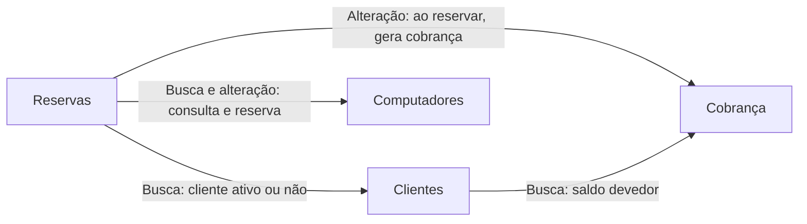
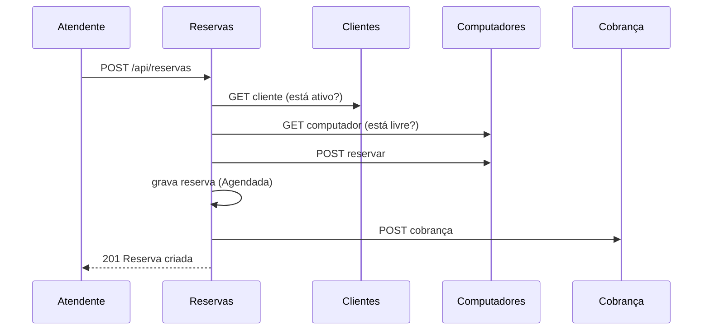

# LanHouse: back-end em microsserviços

Projeto da disciplina Arquitetura de Software, Engenharia de Software, UNISATC.
Avaliação: Sistemas distribuídos. Professor: Eduardo Cizeski Meneghel.

Equipe: [NOME DO INTEGRANTE 1], [NOME DO INTEGRANTE 2], [NOME DO INTEGRANTE 3]

## Aplicação publicada

| Serviço | Endereço (Render) | Documentação interativa |
|---|---|---|
| Reservas | `https://[URL-RESERVAS].onrender.com` | `/scalar` |
| Clientes | `https://[URL-CLIENTES].onrender.com` | `/scalar` |
| Computadores | `https://[URL-COMPUTADORES].onrender.com` | `/scalar` |
| Cobrança | `https://[URL-COBRANCA].onrender.com` | `/scalar` |

O plano gratuito do Render suspende o serviço após alguns minutos sem uso, e a primeira requisição pode levar cerca de 50 segundos para ser respondida. Para acordar todos os serviços antes de testar, acesse `/health` em cada um deles.

---

## 1. Documento de requisitos

### 1.1 Propósito do sistema

Controlar o funcionamento de uma lan house: cadastro de clientes e computadores, reserva de horários e acompanhamento do saldo devedor de cada cliente. O objetivo é substituir as anotações manuais e automatizar o fluxo de atendimento.

### 1.2 Usuários

Colaboradores da lan house, ou seja, as pessoas que a administram: gerentes e atendentes.

### 1.3 Requisitos funcionais

| Código | Requisito | Microsserviço |
|---|---|---|
| RF01 | Cadastrar cliente com nome, telefone e situação (ativo ou bloqueado). | Clientes |
| RF02 | Consultar cliente por nome ou telefone. | Clientes |
| RF03 | Cadastrar computador com identificação, tipo e hardware. | Computadores |
| RF04 | Alterar o status de um computador (livre, reservado ou em uso). | Computadores |
| RF05 | Iniciar sessão a partir de um agendamento, somente se o cliente estiver ativo. | Reservas |
| RF06 | Gerar reserva apenas para computadores que estão livres. | Reservas |
| RF07 | Ao reservar, gerar automaticamente a cobrança correspondente. | Reservas e Cobrança |
| RF08 | Consultar o saldo devedor de um cliente. | Clientes e Cobrança |
| RF09 | Finalizar uma sessão, liberando o computador. | Reservas |
| RF10 | Cancelar uma reserva agendada, liberando o computador e cancelando a cobrança. | Reservas |
| RF11 | Registrar o pagamento de uma cobrança. | Cobrança |

### 1.4 Regras de negócio

- O telefone do cliente é único e a identificação do computador é única.
- A duração de uma reserva vai de 15 a 720 minutos.
- Valor da cobrança = valor da hora do computador x duração em minutos / 60.
- Saldo devedor = soma das cobranças com status `Pendente`.
- Status de computador: `Livre`, `Reservado`, `EmUso`.
- Status de reserva: `Agendada`, `EmAndamento`, `Finalizada`, `Cancelada`.
- Status de cobrança: `Pendente`, `Paga`, `Cancelada`.

---

## 2. Descritivo técnico

### 2.1 Visão geral

A aplicação é composta por 4 microsserviços independentes. Cada um possui seu próprio banco SQLite, sua API REST e seu deploy. Todos seguem o template de microsserviço da disciplina: .NET, Entity Framework Core, SQLite, REST, classe `GeradorDeServicos` e organização em `Controllers`, `Servicos` e `DTO`.



### 2.2 Microsserviços

| Microsserviço | Responsabilidade | Banco | Porta local |
|---|---|---|---|
| Clientes | Cadastro, consulta e situação (ativo ou bloqueado) dos clientes. Consulta o saldo devedor no serviço de Cobrança. | `clientes.db` | 5001 |
| Computadores | Cadastro dos computadores (identificação, tipo, hardware e valor da hora) e controle do status. | `computadores.db` | 5002 |
| Reservas | Coordena o fluxo principal: agenda reservas, inicia e finaliza sessões. Consome os outros três serviços. | `reservas.db` | 5003 |
| Cobrança | Gera, paga e cancela cobranças e calcula o saldo devedor por cliente. | `cobranca.db` | 5004 |

### 2.3 Integrações entre os microsserviços

| # | Tipo | Origem para destino | O que acontece |
|---|---|---|---|
| 1 | Busca | Reservas para Clientes | `GET /api/clientes/{id}`: verifica se o cliente existe e está ativo. |
| 2 | Busca | Reservas para Computadores | `GET /api/computadores/{id}`: verifica se o computador está livre. |
| 3 | Busca | Clientes para Cobrança | `GET /api/cobrancas/cliente/{id}/saldo`: obtém o saldo devedor. |
| 4 | Alteração | Reservas para Computadores | `POST /api/computadores/{id}/reservar`: muda o status para `Reservado`. Também usa `PUT /api/computadores/{id}/status` para `EmUso` e `Livre`. |
| 5 | Alteração | Reservas para Cobrança | `POST /api/cobrancas`: gera a cobrança ao reservar. Usa `PUT /api/cobrancas/{id}/cancelar` ao cancelar. |

Fluxo de criação de uma reserva (`POST /api/reservas`):



Como não existe transação distribuída entre bancos diferentes, o serviço de Reservas faz uma compensação quando alguma etapa falha depois que o computador já foi reservado: libera o computador, cancela a cobrança (se ela chegou a ser criada) e remove a reserva.

### 2.4 Principais endpoints

Clientes:
- `POST /api/clientes`
- `GET /api/clientes?nome=&telefone=`
- `GET /api/clientes/{id}`
- `PUT /api/clientes/{id}/situacao`
- `GET /api/clientes/{id}/saldo-devedor`

Computadores:
- `POST /api/computadores`
- `GET /api/computadores?status=`
- `GET /api/computadores/{id}`
- `PUT /api/computadores/{id}/status`
- `POST /api/computadores/{id}/reservar`

Reservas:
- `POST /api/reservas`
- `GET /api/reservas?clienteId=&status=`
- `GET /api/reservas/{id}`
- `POST /api/reservas/{id}/iniciar-sessao`
- `POST /api/reservas/{id}/finalizar`
- `POST /api/reservas/{id}/cancelar`

Cobrança:
- `POST /api/cobrancas`
- `GET /api/cobrancas?clienteId=&status=`
- `GET /api/cobrancas/{id}`
- `GET /api/cobrancas/cliente/{clienteId}/saldo`
- `PUT /api/cobrancas/{id}/pagar`
- `PUT /api/cobrancas/{id}/cancelar`

Todos os serviços expõem também `GET /health` e a documentação interativa (Scalar) em `/scalar`. As respostas de erro seguem o formato `{ "erro": "mensagem" }`.

### 2.5 Decisões de arquitetura

- Banco por serviço: nenhum serviço acessa o banco de outro. A comunicação acontece apenas por REST.
- Sem código compartilhado: cada serviço mantém seus próprios DTOs. Os contratos dos serviços externos ficam na pasta `DTO` e nas classes de cliente da pasta `Infra`.
- URLs configuráveis: os endereços dos outros serviços vêm da seção `Servicos` do `appsettings.json` e, no Render, são sobrescritos por variáveis de ambiente (`Servicos__Clientes`, `Servicos__Computadores`, `Servicos__Cobranca`).
- Criação do banco: `EnsureCreated()` na inicialização, com dados de demonstração nos serviços de Clientes e Computadores.
- Timeout de 120 segundos nas chamadas entre serviços, para suportar o tempo de despertar das instâncias do plano gratuito.

### 2.6 Limitações conhecidas

- O SQLite no plano gratuito do Render não é persistente: os dados voltam ao estado inicial quando o serviço reinicia.
- Não há autenticação nem controle de perfis de usuário.
- A compensação em caso de falha é feita em melhor esforço, já que não há transação distribuída.

---

## 3. Como executar localmente

Requisito: [.NET SDK 10](https://dotnet.microsoft.com/download).

Abra 4 terminais, um para cada serviço:

```bash
cd Cobranca/Cobranca && dotnet run --launch-profile http          # http://localhost:5004
cd Computadores/Computadores && dotnet run --launch-profile http  # http://localhost:5002
cd Clientes/Clientes && dotnet run --launch-profile http          # http://localhost:5001
cd Reservas/Reservas && dotnet run --launch-profile http          # http://localhost:5003
```

Exemplos prontos de requisições estão no arquivo [`requisicoes.http`](requisicoes.http), que pode ser executado no VS Code (extensão REST Client) ou no Visual Studio.

Dados de demonstração: clientes 1 e 2 (ativos) e 3 (bloqueado); computadores 1 a 4.

## 4. Publicação no Render

Cada microsserviço é um Web Service separado, no plano Free, apontando para este mesmo repositório.

| Campo | Valor (exemplo para Clientes) |
|---|---|
| Language | Docker |
| Dockerfile Path | `./Clientes/Dockerfile` |
| Docker Build Context Directory | `./Clientes` |
| Instance Type | Free |

Ordem de publicação e variáveis de ambiente:

1. Cobrança e Computadores (sem variáveis).
2. Clientes: `Servicos__Cobranca` com a URL pública da Cobrança.
3. Reservas: `Servicos__Clientes`, `Servicos__Computadores` e `Servicos__Cobranca` com as URLs públicas de cada serviço.

Novos commits na branch principal disparam um novo deploy automaticamente.

## 5. Melhorias futuras

- Comunicação assíncrona entre Reservas e Cobrança, com fila de mensagens.
- Observabilidade com logs estruturados e rastreamento distribuído (OpenTelemetry).
- Integração com IA, por exemplo para sugerir um computador conforme o histórico do cliente.
- Bloqueio automático de clientes com saldo devedor acima de um limite.
- Autenticação e perfis de acesso para gerentes e atendentes.
